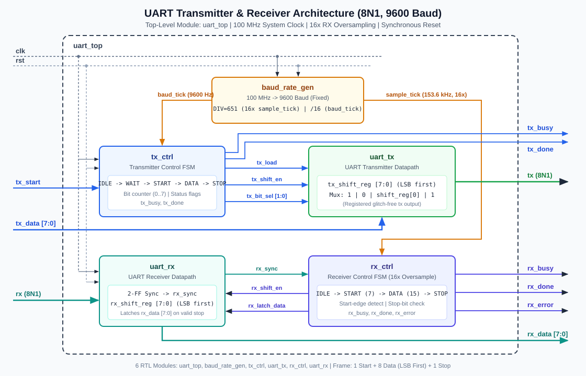

# UART Transmitter and Receiver Using Verilog HDL

A modular, synthesizable **8N1 UART Transmitter and Receiver** operating at **9600 baud** (from a **100 MHz** system clock) implemented in **Verilog-2001 HDL** with self-checking testbenches, Vivado XSIM simulation scripts, XDC timing constraints, and Vivado RTL synthesis scripts.



---

## Specifications

| Parameter | Value |
| :--- | :--- |
| **Protocol** | UART Serial Communication |
| **Data Width** | 8 bits (`[7:0]`) |
| **Baud Rate** | 9600 bps (fixed, +0.0064% error @ 100 MHz) |
| **Frame Format** | 8N1 (1 Start bit `0`, 8 Data bits LSB-first, No Parity, 1 Stop bit `1`) |
| **RX Sampling** | 16× oversampling (`153.6 kHz` sample tick, mid-bit sampling) |
| **Reset** | Active-high synchronous reset (`rst`) |
| **Target Toolchain** | Xilinx Vivado & Vivado Simulator (XSIM) |

---

## Repository Structure

```text
UART_Design/
├── rtl/
│   ├── baud_rate_gen.v             # 16x sample_tick & 1x 9600-baud tick generator
│   ├── tx_ctrl.v                   # Transmitter 8N1 FSM & status control logic
│   ├── uart_tx.v                   # TX shift register (LSB-first) & registered tx output
│   ├── rx_ctrl.v                   # Receiver 16x oversampling FSM & stop-bit verifier
│   ├── uart_rx.v                   # 2-FF input synchronizer, RX shift register & latch
│   └── uart_top.v                  # Top-level UART module integrating TX, RX & baud gen
├── testbench/
│   ├── tb_uart_tx.v                # Transmitter unit testbench (start, LSB-first, stop, baud)
│   ├── tb_uart_rx.v                # Receiver unit testbench (glitch reject, framing error, RX)
│   └── tb_uart_top.v               # Top-level TX, RX & loopback verification testbench
├── simulation/
│   ├── run_xsim.tcl                # XSIM batch script for waveform capture
│   ├── run_sim.bat                 # Windows launcher compiling & running all 3 testbenches
│   ├── tb_uart_top_behav.wcfg      # Vivado XSIM waveform configuration
│   └── README.md                   # Simulation & baud-timing inspection guide
├── synthesis/
│   ├── create_vivado_project.tcl   # Vivado GUI (.xpr) project generator
│   ├── run_vivado_synth.tcl        # Non-project Vivado synthesis & report script
│   ├── run_synth.bat               # Windows batch launcher for Vivado synthesis
│   ├── reports/                    # Output directory for .rpt and .dcp reports
│   └── README.md                   # Synthesis & LUT/FF/timing analysis guide
├── constraints/
│   └── uart_top.xdc                # 100 MHz clock & I/O delay XDC constraints
├── docs/
│   ├── uart_architecture.svg       # Block-level RTL architecture diagram
│   ├── architecture.md             # Module specifications & 8N1 timing specification
│   ├── verification_plan.md        # Test matrix & pass/fail criteria
│   └── interview_prep.md           # VLSI placement interview Q&A guide
├── .gitignore
├── LICENSE
└── README.md
```

---

## RTL Module Summary

1. **`baud_rate_gen`** (`rtl/baud_rate_gen.v`): Generates 16× oversampling ticks (`sample_tick` every 651 clocks) and 9600 Hz TX bit-boundary ticks (`baud_tick` every 10,416 clocks) from a 100 MHz clock.
2. **`uart_tx`** (`rtl/uart_tx.v`): 8-bit LSB-first serial shift register and registered glitch-free `tx` output.
3. **`uart_rx`** (`rtl/uart_rx.v`): 2-FF synchronizer (`rx_sync`), 8-bit serial-to-parallel shift register, and parallel `rx_data` output latch.
4. **`tx_ctrl`** (`rtl/tx_ctrl.v`): TX control FSM (`TX_IDLE`, `TX_WAIT_TICK`, `TX_START`, `TX_DATA`, `TX_STOP`) driving `tx_load`, `tx_shift_en`, `tx_bit_sel`, `tx_busy`, and `tx_done`.
5. **`rx_ctrl`** (`rtl/rx_ctrl.v`): RX 16× oversampling FSM (`RX_IDLE`, `RX_START`, `RX_DATA`, `RX_STOP`) handling start-edge detection, start glitch rejection, mid-bit data sampling, stop-bit verification, `rx_busy`, `rx_done`, and `rx_error`.
6. **`uart_top`** (`rtl/uart_top.v`): Top-level module connecting all five submodules cleanly.

---

## Verification Coverage

The testbench suite (`testbench/tb_uart_tx.v`, `testbench/tb_uart_rx.v`, `testbench/tb_uart_top.v`) verifies:
- Synchronous reset behavior on all TX/RX outputs
- Single-byte transmission and reception
- Start bit (`0`) generation and mid-bit validation (plus glitch rejection)
- LSB-first serial ordering (`bit[0]` -> `bit[7]`) verified using asymmetric bytes (`0xA3`, `0x9D`)
- Stop bit (`1`) generation and framing error (`rx_error`) detection on low stop bits
- 9600-baud bit period accuracy (`~104,160 ns` per bit)
- Full TX-to-RX loopback communication (single byte and multi-byte sequences)

---

## Running Simulation & Synthesis in Xilinx Vivado

### 1. Behavioral Simulation (Vivado XSIM)

From `simulation/` in a Vivado Command Prompt:

```bat
run_sim.bat
xsim --gui tb_uart_top_sim.wdb -view tb_uart_top_behav.wcfg
```

See [simulation/README.md](simulation/README.md) for waveform inspection details.

### 2. RTL Synthesis (Vivado)

From `synthesis/` in a Vivado Command Prompt:

```bat
run_synth.bat
```

This runs `synth_design -top uart_top` with `constraints/uart_top.xdc` (100 MHz clock constraint) and writes `utilization_synth.rpt`, `timing_summary_synth.rpt`, `clock_utilization_synth.rpt`, `drc_synth.rpt`, and `power_synth.rpt` into `synthesis/reports/`. See [synthesis/README.md](synthesis/README.md) for analysis steps.

---

## Documentation

- [Architecture Specification](docs/architecture.md)
- [Verification Plan](docs/verification_plan.md)
- [VLSI Placement Interview Q&A](docs/interview_prep.md)
