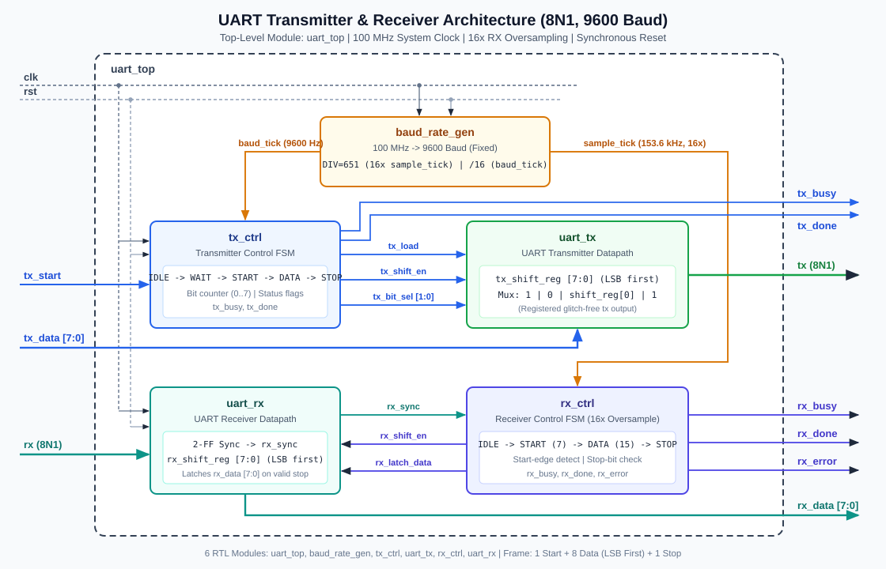

# UART Transmitter and Receiver Architecture Specification

## 1. Design Overview

This project implements a full-duplex **8N1 UART Transmitter and Receiver** operating at a fixed **9600 baud** from a **100 MHz** single system clock (`clk`) with active-high synchronous reset (`rst`).



## 2. Top-Level Interface (`uart_top`)

| Port | Direction | Width | Domain / Group | Description |
| :--- | :--- | :--- | :--- | :--- |
| `clk` | Input | 1 | System | 100 MHz system clock (rising-edge triggered) |
| `rst` | Input | 1 | System | Active-high synchronous reset |
| `tx_start` | Input | 1 | Transmitter | Start pulse to initiate 8N1 frame transmission (ignored while `tx_busy=1`) |
| `tx_data` | Input | 8 | Transmitter | Parallel byte to serialize (transmitted LSB-first) |
| `tx` | Output | 1 | Transmitter | Serial TX output line (idles high `1'b1`) |
| `tx_busy` | Output | 1 | Transmitter | High while frame transmission is pending or active |
| `tx_done` | Output | 1 | Transmitter | Single-clock pulse asserted when Stop bit completes |
| `rx` | Input | 1 | Receiver | Serial RX input line (idles high `1'b1`) |
| `rx_data` | Output | 8 | Receiver | Received 8-bit parallel byte |
| `rx_busy` | Output | 1 | Receiver | High while start/data/stop reception is active |
| `rx_done` | Output | 1 | Receiver | Single-clock pulse when valid Stop bit is verified (`rx_data` valid) |
| `rx_error` | Output | 1 | Receiver | High if Stop bit failed (`0` at mid-bit); cleared on next valid frame or reset |

## 3. Module Hierarchy & Responsibilities

```
uart_top
├── u_baud_rate_gen (baud_rate_gen) : 16x RX sample_tick & 1x TX baud_tick
├── u_tx_ctrl       (tx_ctrl)       : TX 8N1 control FSM & bit counter
├── u_uart_tx       (uart_tx)       : TX shift register & registered serial output
├── u_rx_ctrl       (rx_ctrl)       : RX 16x oversampling FSM & stop-bit check
└── u_uart_rx       (uart_rx)       : 2-FF input synchronizer, RX shift register, output latch
```

### 3.1 `baud_rate_gen` — Baud Rate Generator
- Derives fixed **9600 baud** from a **100 MHz** clock using integer oversampling division:
  - `SAMPLE_DIV = 100,000,000 / (9600 * 16) = 651` clocks per `sample_tick` (`153,609.83 Hz`)
  - `baud_tick` fires every `16` `sample_tick` pulses = `10,416` clocks (`9,600.61 bps`, **+0.0064% error**).
- Outputs single-cycle pulses (`sample_tick`, `baud_tick`) synchronized to `clk`.

### 3.2 `tx_ctrl` & `uart_tx` — Transmitter Control & Datapath
- **States**: `TX_IDLE -> TX_WAIT_TICK -> TX_START -> TX_DATA (0..7) -> TX_STOP -> TX_IDLE`
- When `tx_start=1` in `TX_IDLE`, `tx_load` latches `tx_data` into `tx_shift_reg`.
- Transitioning on `baud_tick` ensures every bit (Start `0`, D0..D7 LSB-first, Stop `1`) spans **exact** `10,416` clock cycles (`104.16 µs`).
- `uart_tx` registers `tx` on `posedge clk` (`1'b1` on reset) so the serial output pin is strictly glitch-free.

### 3.3 `rx_ctrl` & `uart_rx` — Receiver Control & Datapath (16x Oversampling)
- **2-FF Input Synchronizer (`uart_rx`)**: Double-registers external `rx` into `rx_sync` (initialized to `1'b1` on reset).
- **Start-Bit Detection & Glitch Rejection (`rx_ctrl`)**:
  - Detects falling edge (`rx_sync_d & ~rx_sync`) in `RX_IDLE`.
  - Waits `7` `sample_tick` pulses (`~7.5` ticks = half bit period) to sample the Start bit near its center; if `rx_sync == 1'b1`, aborts false-start glitch back to `RX_IDLE`.
- **Mid-Bit Data & Stop Sampling**:
  - Samples every `16` `sample_tick`s (`sample_cnt == 15`), placing all 8 data samples (`D0..D7`) and the Stop-bit sample near the exact center of each `104.16 µs` bit window.
  - Shifts right (`{rx_sync, rx_shift_reg[7:1]}`) so LSB arrives in bit 0 after 8 shifts.
  - At mid-Stop bit: if `rx_sync == 1'b1`, latches `rx_data <= rx_shift_reg`, clears `rx_error`, and pulses `rx_done`; if `rx_sync == 1'b0`, asserts `rx_error` without overwriting `rx_data` (and falling-edge detection prevents re-triggering on the remainder of the low stop bit).

## 4. 8N1 Serial Frame Format

```
Idle   Start   D0    D1    D2    D3    D4    D5    D6    D7   Stop   Idle
 1   |   0   | LSB | b1  | b2  | b3  | b4  | b5  | b6  | MSB |  1   |  1
     |<----- 104.16 us per bit (10,416 clocks @ 100 MHz) ----->|
```
